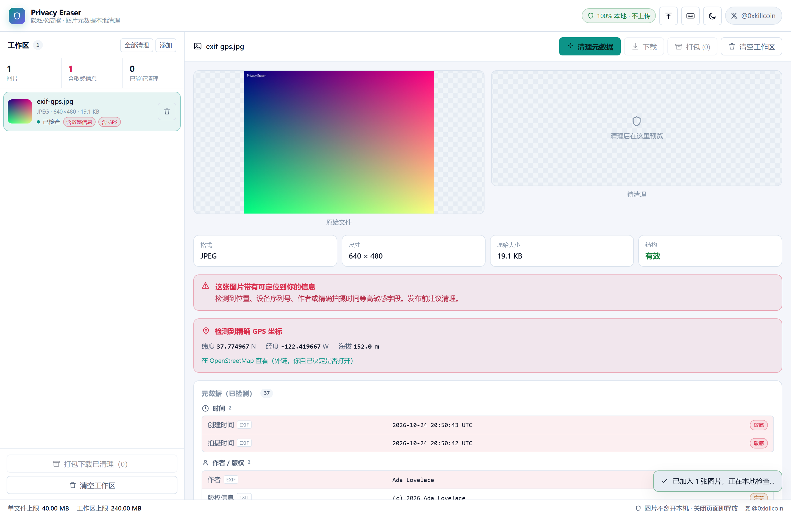
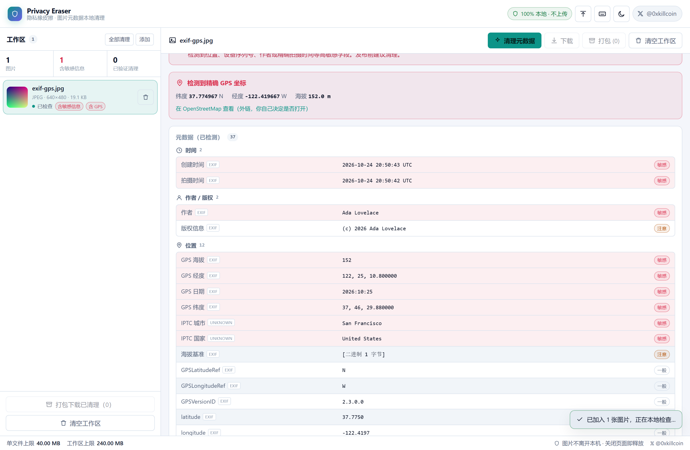
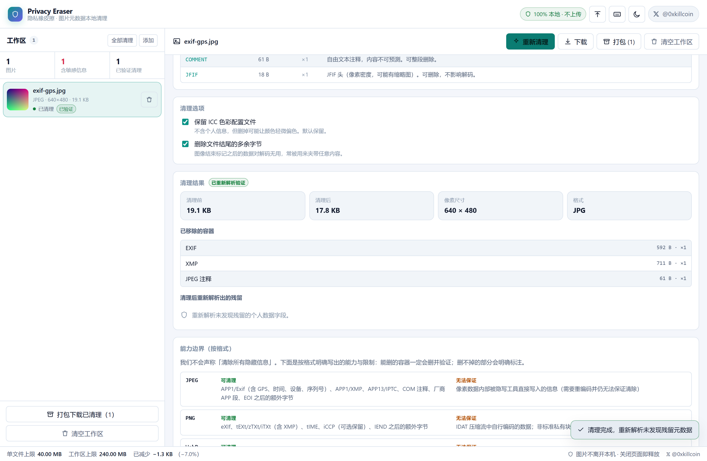
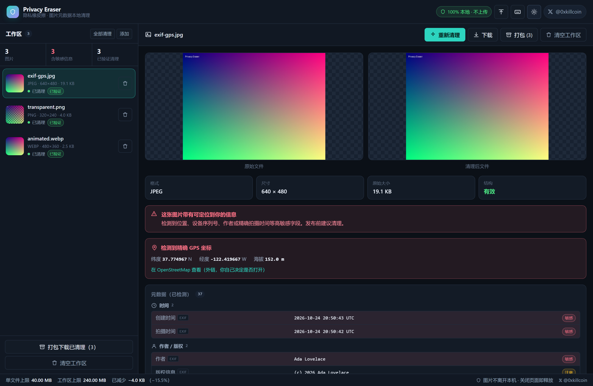
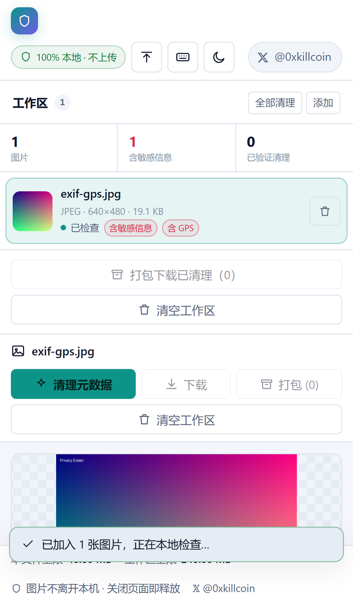
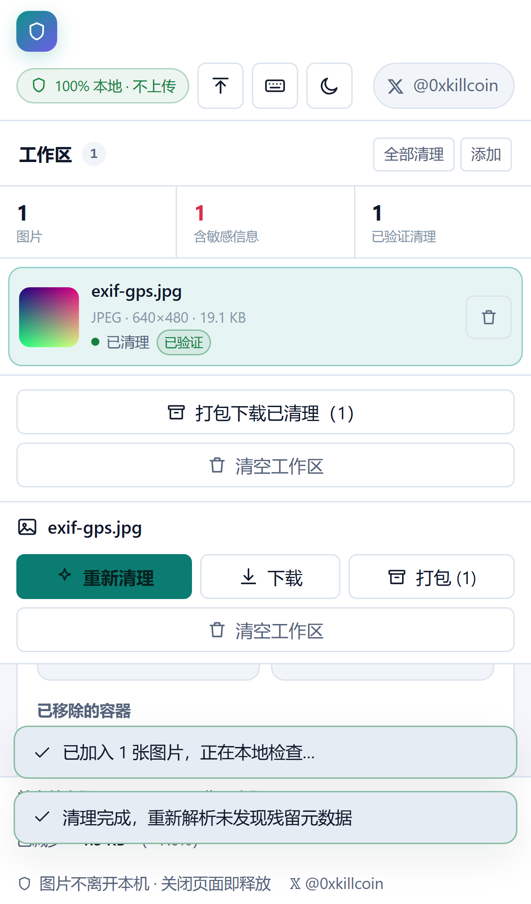

<div align="center">

# Privacy Eraser · 隐私橡皮擦

**在浏览器里看清一张图片到底暴露了什么，然后真正把它删掉。**
**图片不上传、不落盘、不联网 —— 关闭页面即释放。**

[](https://iiiiiiiiiiiiiKK.github.io/privacy-eraser/)
[](https://github.com/iiiiiiiiiiiiiKK/privacy-eraser/actions/workflows/ci.yml)
[](LICENSE)
[](https://x.com/0xkillcoin)

[在线使用](https://iiiiiiiiiiiiiKK.github.io/privacy-eraser/) · [支持的格式](#支持的格式) · [清理能力边界](#清理能力边界) · [隐私说明](#隐私与安全) · [本地开发](#本地开发)

作者：**𝕏 [@0xkillcoin](https://x.com/0xkillcoin)**

</div>

---

<div align="center">



<sub>左侧工作区（可批量）· 中间原始 / 清理后双预览 · 右侧按类别分组的元数据、容器统计、清理选项与验证结果</sub>

</div>

---

## 它解决什么问题

一张手机拍的照片，除了你看到的画面，还带着这些东西：

| 藏在哪里 | 通常包含 |
| --- | --- |
| **EXIF** | 相机厂商与型号、镜头与序列号、**精确 GPS 坐标**、拍摄时间（到秒）、ISO / 光圈 / 焦距、方向、作者名、软件版本 |
| **XMP** | Adobe 系列写入的编辑历史、作者、版权、城市/国家、CreatorTool |
| **IPTC / Photoshop IRB** | 作者、署名、城市、说明、关键词 |
| **PNG 文本块** | 软件名、注释、有时是整段 XMP |
| **文件尾** | 图像结束标记之后的任意字节（可夹带任何东西） |

发到社交平台前，「把元数据删掉」通常靠截图或者用画图重新保存——前者会降画质，后者会改格式，而且**没有人验证结果**。Privacy Eraser 做三件事，并且只做这三件事：

1. **看清**：逐字段列出可解析的元数据，标出哪些是敏感字段，GPS 直接给出坐标；
2. **删掉**：按容器**在字节层删除**（不重编码、不损失画质、不改格式），一次性处理单张或整批；
3. **验证**：**重新解析导出的字节**，把「已清理」「无法验证」明确分开，绝不宣称「清除了所有隐藏信息」。

## 功能

### 上传

- **拖放**图片到窗口任意位置，或用文件选择器 / `Ctrl+O`；
- 支持**批量**（一次多选、多次追加），左侧工作区列出每张图的状态、格式、尺寸、大小；
- 单文件上限 **40 MB**，工作区总量上限 **240 MB**，超限直接拒绝并说明原因（保护内存，而不是让浏览器崩掉）；
- 格式按**魔数**判断，不看扩展名：`photo.jpg` 其实是 PNG 也能正确处理。

### 检查

- **预览**：原图与清理后并排显示（透明区域用棋盘格背景，便于确认 alpha 没有被压成黑底）；
- **基础信息**：格式、像素尺寸、文件大小、结构是否有效；
- **元数据表**：按「位置 / 设备 / 时间 / 作者 / 软件 / 图像参数 / 色彩」分组，每一行标注敏感度（敏感 / 注意 / 一般 / 技术）和所属容器（EXIF / XMP / IPTC / ICC）；
- **GPS 卡片**：经纬度 + 海拔 + 原始 N/S、E/W 参考值，并提供 OpenStreetMap 外链（只有你主动点击才会离开本站）；
- **容器统计**：每种容器占多少字节、出现几次、是否可删除，以及它是什么；
- **风险提示**：按最高敏感度给出「这张图片带有可定位到你的信息 / 一些可识别信息 / 少量技术信息 / 没有可解析元数据」——不吓唬人，只说事实。

<div align="center">



</div>

### 清理

- **字节级删除**，不是画布重绘：

  | 格式 | 做法 | 画质 |
  | --- | --- | --- |
  | JPEG | 重写段流：丢弃 APP1/Exif、APP1/XMP、APP13/IPTC、COM、厂商 APP 段，**原样复制压缩图像数据** | 无损，像素不变 |
  | PNG | 丢弃 eXIf / tEXt / zTXt / iTXt / tIME（iCCP 可选）等辅助块，**保留 IHDR/PLTE/IDAT/IEND 与 APNG 帧** | 无损，像素不变 |
  | WebP | 从 RIFF 容器中移除 EXIF / XMP（ICCP 可选）块，**重写 RIFF 长度与 VP8X 标志位** | 无损，像素不变 |

- **选项**：
  - `保留 ICC 色彩配置文件`（默认开）——不含个人信息，删掉可能轻微偏色；
  - `删除文件结尾的多余字节`（默认开）——EOI / IEND / RIFF 之后的任何东西都清掉。
- **批处理**：左侧「全部清理」一次处理整批，「打包下载」输出一个 ZIP（内存中生成，`fflate`）。
- **导出**：单张下载为 `原名-clean.jpg|png|webp`，批量下载为 `privacy-eraser-clean.zip`。

<div align="center">



</div>

### 验证（这才是重点）

清理完成后，**不是**只更新界面上的标签，而是：

1. 用同一套容器扫描器**重新解析导出的字节**；
2. 用 `exifr` 做**第二遍独立解析**；
3. 两遍都找不到个人数据字段，且结构可解析，才显示 **「已重新解析验证」**；否则显示 **「无法完全验证」** 并列出原因（例如「清理后仍能解析出 GPS 坐标，请勿发布该文件」）。

界面上三类状态严格区分：

| 状态 | 含义 |
| --- | --- |
| **已检测** | 我们解析出来并展示给你的字段 |
| **已清理** | 从导出字节中确实移除的容器（附字节数与次数） |
| **无法验证** | 我们无法证明已清除的部分（写进「验证说明」，不隐藏） |

## 支持的格式

| 格式 | 检测 | 元数据读取 | 清理导出 | 说明 |
| --- | :---: | :---: | :---: | --- |
| **JPEG** (`.jpg` `.jpeg`) | ✅ | ✅ EXIF / XMP / IPTC / ICC / JFIF / COM | ✅ 字节级 | 主力格式，能力最完整 |
| **PNG** (`.png`, 含 APNG) | ✅ | ✅ eXIf / tEXt / zTXt / iTXt / iCCP / tIME | ✅ 字节级 | 保留 alpha 与动画帧 |
| **WebP** (`.webp`, 含动画) | ✅ | ✅ EXIF / XMP / ICCP | ✅ 字节级 | 元数据由内置 TIFF 解析器读取 |
| **GIF** | ✅ | 仅提示 | ❌ | 已识别但暂不支持清理 |
| **AVIF / HEIC** | ✅ | 仅提示 | ❌ | ISOBMFF 容器，重写 box 结构未实现 |
| **TIFF / BMP** | ✅ | 仅提示 | ❌ | 不在范围内 |
| 其他 | ✅ | — | — | 明确报「无法识别的文件格式」 |

> `exifr` 覆盖 JPEG 与 PNG，但**不解析 WebP 里的 EXIF 块**。为了避免「看着干净、其实带着 GPS」，本项目内置了一个小型 TIFF/EXIF 读取器（`src/lib/tiff.ts`）专门读 WebP 的 `EXIF` 快，并用容器扫描器读 `XMP` 块。

## 清理能力边界

**我们不会说「清除了所有隐藏信息」。** 下面这张表也原样出现在界面里：

| 格式 | 可清理（并验证） | 无法保证 |
| --- | --- | --- |
| **JPEG** | APP1/Exif（GPS、时间、设备、序列号）、APP1/XMP、APP13/IPTC、COM 注释、厂商 APP 段、EOI 之后的多余字节 | 被隐写工具直接写进像素数据的信息（任何元数据工具都读不到） |
| **PNG** | eXIf、tEXt/zTXt/iTXt（含 XMP）、tIME、iCCP（可选保留）、IEND 之后的多余字节 | IDAT 压缩流里自行编码的数据；未知私有块的具体含义 |
| **WebP** | EXIF 块、XMP 块、ICCP（可选保留）、RIFF 声明之外的字节 | VP8/VP8L 位流中编码的自定义数据 |

其他已知限制：

- **不修改像素**：本工具只删元数据容器，不做重编码。所以它不会「洗掉」压进像素里的水印或隐写内容；
- **ICC 与颜色**：默认保留 iCCP/ICCP，避免颜色偏移；如果你选择删除，导出文件的颜色可能与原图略有差异；
- **EXIF 方向（Orientation）**：我们的 JPEG 清理会一并删除 EXIF，某些老式查看器可能不再自动旋转照片。现代浏览器与系统相册按像素显示，不受影响；
- **损坏/截断文件**：结构无法安全重写时会**拒绝清理**并说明原因，而不是产出一个打不开的文件；
- **不支持的对象**：GIF / AVIF / HEIC / TIFF / BMP 只做检测与说明，不会假装清理成功。

## 界面

- **流程清晰**：上传 → 检查 → 清理 → 导出，工作台布局（左工作区 / 主详情 / 底部状态栏）；
- **双预览**：原始 vs 清理后，透明图用棋盘格背景；
- **浅色 + 深色**主题（首屏前恢复，不闪白）；跟随系统偏好；
- **手机自适应**：≤900px 时上下堆叠，操作按钮拉满整行，表格改为单列，状态栏换行——**没有横向溢出**（有 E2E 用例守着）；
- **键盘可操作**：`Tab` 可达全部控件，树的每一行都是可聚焦按钮，`Esc` 关闭对话框；
- **空状态**：首次进入是完整的说明页，而不是一块空白；
- 顶部与底部都有作者 **𝕏 [@0xkillcoin](https://x.com/0xkillcoin)** 链接。

<div align="center">






</div>

## 快捷键

`Ctrl` 在 macOS 上对应 `⌘`。

| 快捷键 | 动作 |
| --- | --- |
| `Ctrl + O` | 选择图片文件 |
| `Ctrl + Enter` | 清理当前图片 |
| `Ctrl + S` | 下载清理后的图片 |
| `Ctrl + Shift + Z` | 清空工作区 |
| `Ctrl + Shift + T` | 切换深色 / 浅色 |
| `Delete` | 移除当前选中的图片 |
| `Esc` | 关闭对话框 / 取消拖放 |

## 隐私与安全

- **默认不上传。** 应用是纯静态站点，没有后端、没有 API、没有分析 SDK、没有错误上报；E2E 里有一条用例断言「除同源静态资源外没有任何网络请求」；
- **不持久化图片。** 图片只存在于当前标签页的内存里；没有 IndexedDB，没有 `localStorage` 存图片。唯一写入 `localStorage` 的是主题偏好（`privacy-eraser:theme`）；
- **对象 URL 及时释放。** 预览 URL 在条目被移除、工作区被清空、或页面 `pagehide` 时撤销（清理后预览使用 effect cleanup 撤销），避免长时间使用后的内存泄漏；
- **不信任界面。** 清理结果以「重新解析导出字节」为准；
- **资源边界**：单文件 40 MB、批次 240 MB 上限；JPEG/PNG/WebP 解析器对段长、块长、TIFF 条目数都做了上限与越界检查；损坏文件不会让页面崩溃；
- **没有 eval。** 不使用 `eval` / `new Function`，所有解析都是手写的字节读取；
- **外链只有一个**：GPS 卡片里的 OpenStreetMap 链接（`rel="noopener noreferrer"`），只有你点击才会访问。

## 技术栈

| 层 | 选择 | 说明 |
| --- | --- | --- |
| 框架 | **React 18 + TypeScript 5**（strict） | 函数组件 + hooks |
| 构建 | **Vite 6**（`base: './'`） | 同一份产物可部署在根路径或子路径 |
| EXIF 解析 | **exifr**（MIT） | JPEG / PNG 的 EXIF、XMP、IPTC、ICC |
| WebP EXIF | **自研 TIFF 读取器**（`src/lib/tiff.ts`） | exifr 不支持 WebP 容器 |
| 容器扫描 | **自研**（`jpeg.ts` / `png.ts` / `webp.ts`） | 精确到字节的段/块枚举与重写 |
| 打包下载 | **fflate**（MIT） | 内存中生成 ZIP，不依赖任何 CDN |
| 测试 | **Vitest** + **Playwright** | 28 个单元测试（含真实 fixture 字节）+ 24 个 E2E 用例 |
| 样式 | 原生 CSS + CSS 变量 | 无 UI 框架 |

### 架构

```
src/
├─ lib/
│  ├─ types.ts        # 共享类型（已检测 / 已清理 / 无法验证）
│  ├─ format.ts       # 魔数识别（JPEG/PNG/WebP/GIF/AVIF/HEIC/TIFF/BMP）
│  ├─ jpeg.ts         # JPEG 段流扫描与重写
│  ├─ png.ts          # PNG 块扫描与重写
│  ├─ webp.ts         # RIFF 块扫描与重写（含 VP8X 标志修正）
│  ├─ tiff.ts         # 内置 TIFF/EXIF 读取器（WebP 用）
│  ├─ tiff-tags.ts    # 展示用的 tag 名称表
│  ├─ inspect.ts      # 组合容器扫描 + exifr，产出字段/容器/GPS/风险
│  ├─ clean.ts        # 字节级清理 + 重新解析验证（cleanAndVerify）
│  ├─ download.ts     # Blob 下载与内存 ZIP
│  └─ format-utils.ts # 字节/百分比/坐标格式化
├─ hooks/             # useWorkspace（状态机）/ useTheme / useToasts
├─ components/        # Icon / FileList / MetadataTable / DetailPanel / CleanedPreview
└─ App.tsx            # 布局、拖放、快捷键、导出
fixtures/             # 由 scripts/make_fixtures.py 生成的真实测试图片
```

`src/lib` 不接触 DOM（`clean.ts` 里的 Canvas 重编码兜底除外，它需要 DOM，且当前未在 UI 中启用）。

## 本地开发

需要 Node.js **20+**（CI 用 22）。

```bash
git clone https://github.com/iiiiiiiiiiiiiKK/privacy-eraser.git
cd privacy-eraser
npm ci

npm run dev        # http://localhost:5213
npm run build      # 生产构建 → dist/
npm run preview    # 预览构建产物 http://localhost:4213
```

### 测试图片

`fixtures/` 里的图片**由脚本生成**（不是来路不明的二进制），内容完全可复现：

```bash
python scripts/make_fixtures.py
```

| 文件 | 内容 |
| --- | --- |
| `exif-gps.jpg` | APP1/Exif（厂商、型号、镜头、序列号、时间、GPS 37.7749,-122.4196）+ APP1/XMP + COM |
| `no-metadata.jpg` | 无任何 APP1/COM 段 |
| `transparent.png` | RGBA + tEXt ×2 + iTXt(XMP) + eXIf + tIME |
| `clean.png` | 只有 IHDR/IDAT/IEND |
| `animated.webp` | VP8X + VP8L + EXIF + XMP |
| `clean.webp` | 无元数据 |
| `huge.jpg` | 4000×3000 大图 |
| `broken.jpg` | 在扫描数据中间截断 |
| `not-an-image.txt` | 纯文本（伪装成图片） |
| `unsupported.gif` | GIF87a |

### 运行测试

```bash
npm run test              # 单元测试（Vitest，读取真实 fixture）
npx playwright install chromium
npm run e2e               # 端到端（自动 build + preview，端口 4213）
npm run check             # lint + 单元测试 + 生产构建
```

## 部署

### GitHub Pages（本仓库的实际部署方式）

`.github/workflows/ci.yml` 在 push 到 `main` 时执行：

`Lint → Typecheck → Unit tests → Build → E2E（桌面 + iPhone）→ Deploy to GitHub Pages`

仓库设置 → Pages → Source 选 **GitHub Actions** 即可（一次性）。

线上地址：**https://iiiiiiiiiiiiiKK.github.io/privacy-eraser/**

`vite.config.ts` 用 `base: './'`，因此同一份 `dist/` 也可以直接放到 Cloudflare Pages、Vercel、Netlify 或任意静态目录。

## 测试与验收

```
单元测试（Vitest）：28 个用例           ✅
端到端（Playwright）：24 个用例          ✅
  ├─ desktop-chromium @1440×940  19 用例
  └─ iphone-13 (390×844, DPR3)    5 用例
生产构建 + ESLint（--max-warnings 0）    ✅
```

已验证的行为（节选）：

- **清理结果是对字节的断言，而不只是界面文字**：E2E 会下载清理后的文件，直接检查字节里不再出现 `Exif\0\0` / `http://ns.adobe.com/xap` / `tEXt` / `eXIf` / `EXIF` / `XMP `，同时断言 JPEG 仍以 `FFD8` 开头、以 `FFD9` 结尾，PNG 的 IHDR 颜色类型仍为 6（RGBA），WebP 的 RIFF 长度字段与实际长度一致；
- 透明 PNG 清理后透明度保留；
- 已干净的文件保持幂等（连续两次清理字节长度不变）；
- 损坏 JPEG 给出可理解的错误；不支持格式不会出现「清理成功」；
- 批处理三张图 → 逐个清理 → 打包 ZIP（检查 ZIP 起始 `PK` 与条目数）；
- 清空工作区、移除单张互不影响；
- 深色主题持久化、快捷键（`Ctrl+Enter` 清理、`Ctrl+S` 下载）、快捷键面板；
- **没有任何图片数据离开浏览器**（监听所有请求断言只有同源静态资源）；
- iPhone 13 无横向溢出、触控目标 ≥28px、可完成批处理。

## 已知限制

- 只做元数据清理，**不改像素**：无法去除烧进画面的水印，也无法清除隐写在像素数据里的信息；
- 删除 EXIF 会一并删除 `Orientation`，个别老查看器可能不再自动旋转；
- GIF / AVIF / HEIC / TIFF / BMP 仅检测，不导出清理结果；
- 浏览器内存上限决定批量规模（默认 240 MB 工作区上限，可在源码中调整）；
- 不做「面部/车牌识别」之类的智能检测——那需要上传或本地大模型，不符合这个工具的定位。

## 贡献

Issues / PR 都欢迎。提交前请跑通：

```bash
npm run check && npm run e2e
```

## 许可

[MIT](LICENSE) © 2026 KK ([@0xkillcoin](https://x.com/0xkillcoin))

第三方依赖均为 MIT：React、Vite、exifr、fflate、Vitest、Playwright。测试图片由本项目脚本生成，不含任何第三方素材。

---

<div align="center">

**发图之前，先看一眼它都带了什么。**

𝕏 [@0xkillcoin](https://x.com/0xkillcoin)

</div>
